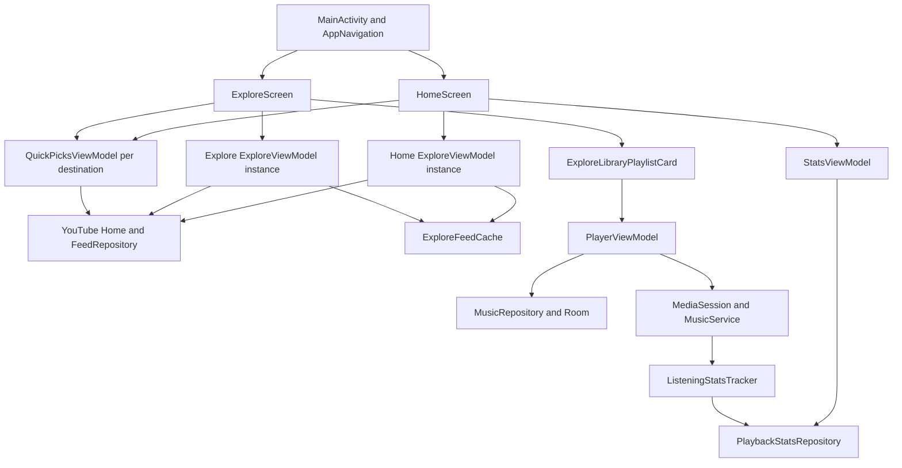

# Home and Explore architecture and memory audit

Home and Explore share app-wide playback and library state. Both screens also create destination-scoped feed ViewModels. Home reads the prepared Discover songs, while Explore renders the feed and owns the selected category, refresh, and pagination.

## Ownership and changes

| File or boundary | Retention or extra work | Implementation |
| --- | --- | --- |
| [HomeScreen.kt](../../app/src/main/java/com/unshoo/pixelmusic/presentation/screens/HomeScreen.kt#L197) | Home observed Explore's full screen model to read the Discover shelf. | Collect a distinct shelf projection when online. |
| [ExploreScreen.kt](../../app/src/main/java/com/unshoo/pixelmusic/presentation/screens/ExploreScreen.kt#L550) | Pull-to-refresh joined wrappers that completed as soon as they scheduled the real work. | Await the ViewModels' refresh jobs and clear the refresh flag in `finally`. |
| [ExploreViewModel.kt](../../app/src/main/java/com/unshoo/pixelmusic/presentation/viewmodel/ExploreViewModel.kt#L480) | Recently added updates accumulated old song objects. Offline Explore retained a lookup for the library even though its consumers need recent and rotating tracks. | Keep just the current recent tracks and relevant history entries in the lookup. Check cancellation before publishing the offline feed. |
| [ExploreFeedCache.kt](../../app/src/main/java/com/unshoo/pixelmusic/presentation/viewmodel/ExploreFeedCache.kt#L17) and [PlaylistViewModel.kt](../../app/src/main/java/com/unshoo/pixelmusic/presentation/viewmodel/PlaylistViewModel.kt#L328) | Explore and the playlist route maintained separate Gson codecs. Concurrent Explore writes shared a temporary filename. | Share the codec, preserve both supported item encodings, bound the serialized cache by bytes, and replace it from a unique temporary file. |
| [ExploreLibraryPlaylistCard.kt](../../app/src/main/java/com/unshoo/pixelmusic/presentation/screens/ExploreLibraryPlaylistCard.kt#L49) and [PlayerViewModel.kt](../../app/src/main/java/com/unshoo/pixelmusic/presentation/viewmodel/PlayerViewModel.kt#L7515) | Cards fetched cover previews even for playlists with their own art. The Play button queued the preview songs. | Query only collage covers and route Play through the existing cancellable full-queue path. |
| [QuickPicksViewModel.kt](../../app/src/main/java/com/unshoo/pixelmusic/presentation/viewmodel/QuickPicksViewModel.kt#L212) | Two startup collectors could start loads together. A previous category could finish after a new selection. | Start one initial load, cancel superseded loads, and keep the current category's data during refresh. |
| [StatsViewModel.kt](../../app/src/main/java/com/unshoo/pixelmusic/presentation/viewmodel/StatsViewModel.kt#L56) and [PlaybackStatsRepository.kt](../../app/src/main/java/com/unshoo/pixelmusic/data/stats/PlaybackStatsRepository.kt#L335) | Range work could overlap, stats retained a second library, artist URLs accumulated, and summaries repeatedly scanned events for each song. | Cancel obsolete range and Home summary jobs, reuse the shared library snapshot, retain images for the current artist list, and index the last event per song once. |
| [ConnectivityStateHolder.kt](../../app/src/main/java/com/unshoo/pixelmusic/presentation/viewmodel/ConnectivityStateHolder.kt#L644) | AudioManager kept an audio-device callback through ViewModel recreation. | Unregister the callback with the receivers and clear their references. |
| [ThemeStateHolder.kt](../../app/src/main/java/com/unshoo/pixelmusic/presentation/viewmodel/ThemeStateHolder.kt#L179) | A palette job cancelled before it ran could leave its request and waiting flows in the singleton. | Release pending flows on job completion, including cancellation before startup. |
| [SleepTimerStateHolder.kt](../../app/src/main/java/com/unshoo/pixelmusic/presentation/viewmodel/SleepTimerStateHolder.kt#L213) and [PlayerViewModel.kt](../../app/src/main/java/com/unshoo/pixelmusic/presentation/viewmodel/PlayerViewModel.kt#L2503) | Each end-of-track timer created an eager shared flow that kept collecting after the timer ended. | Collect a cold song-ID flow inside the timer's own cancellable job. |
| [ListeningStatsTracker.kt](../../app/src/main/java/com/unshoo/pixelmusic/presentation/viewmodel/ListeningStatsTracker.kt#L65) and [MusicService.kt](../../app/src/main/java/com/unshoo/pixelmusic/data/service/MusicService.kt#L2562) | The singleton retained a UI coroutine scope and could load the same history twice. Clearing the UI finalized a service-owned session. | Use the tracker scope for history work, coalesce concurrent loads, and finalize at the playback lifecycle boundary. |

## Performance checks

Use a release build for frame timing. Capture Home and Explore vertical flings and horizontal swipes with frosted navigation enabled, both with idle playback and while music is playing. Use repeated navigation and activity recreation to check that old activities, callbacks, and timer collectors are released. Keep the heap check and frame timing results attached to the build they measure. [Compose performance](https://developer.android.com/develop/ui/compose/performance) · [Android heap dumps](https://developer.android.com/studio/profile/capture-heap-dump)

The source boundaries follow the existing app module. The next dependency boundary to inspect is the Home Discover reader, since it currently creates an ExploreViewModel with feed-wide observers. A future Gradle feature split needs that dependency separated from Explore's category state and the shared playback controls. [Android modularization patterns](https://developer.android.com/topic/modularization/patterns)
